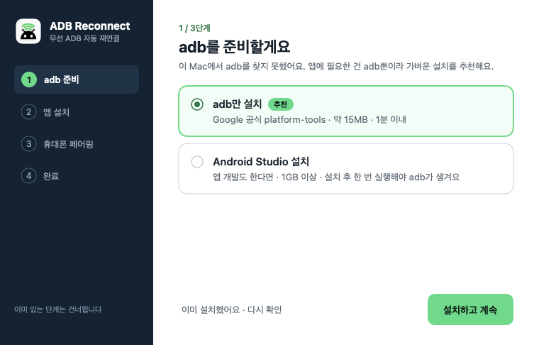
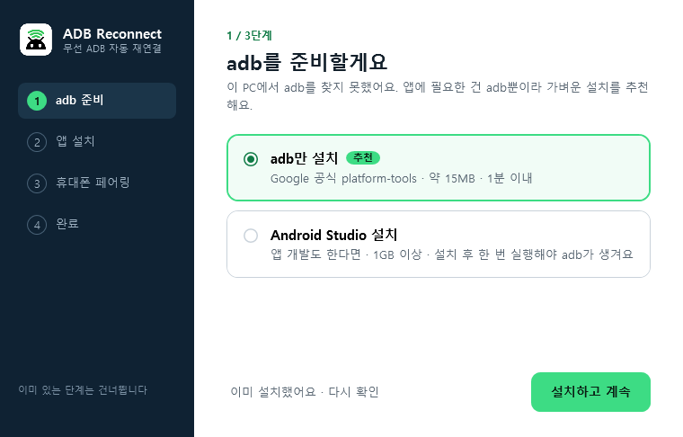
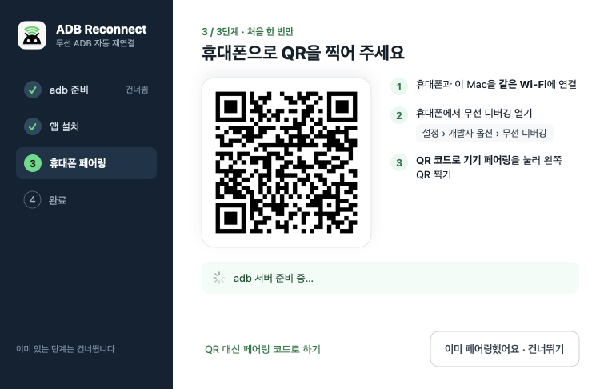
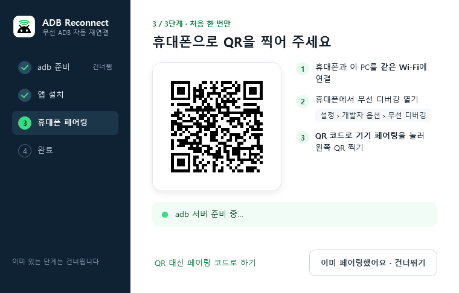
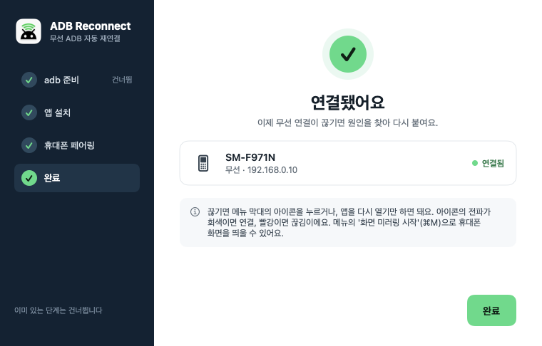
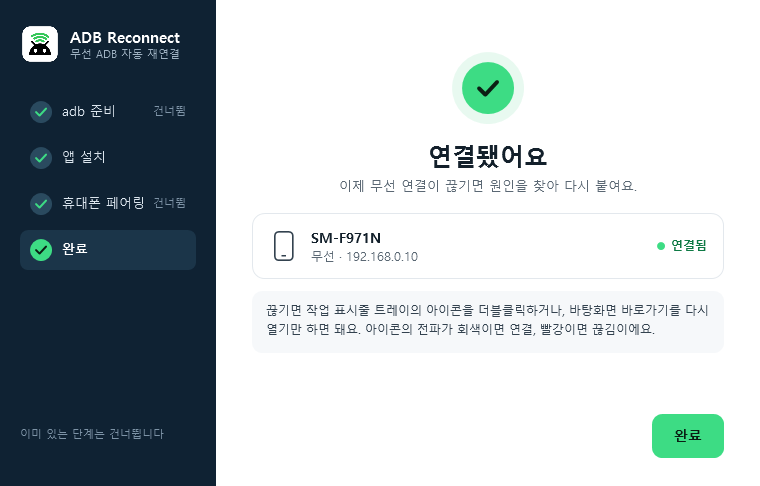

<p align="center">
  
</p>

<h1 align="center">무선 ADB 자동 재연결 <sub>Wireless ADB Reconnect</sub></h1>

<p align="center">
  <b>무선 디버깅이 끊기면 알아서 다시 붙여 줍니다 — macOS · Windows</b><br>
  메뉴 막대 / 트레이 앱이 <i>왜</i> 끊겼는지 찾고, 해결 방법을 순서대로 시도하고, 붙은 방법을 기억합니다.
</p>

<p align="center">
  <a href="../../releases/latest">다운로드</a> ·
  <a href="README.md">English</a> ·
  <a href="#동작-방식">동작 방식</a> ·
  <a href="#문제-해결">문제 해결</a>
</p>

---

## 왜 만들었나

Android 11부터 생긴 **무선 디버깅**은 편하지만 자주 끊깁니다.

- 연결이 끊기고 `adb devices`가 다시 비어 있음
- 무선 디버깅을 다시 켤 때마다 **포트가 바뀜**
- 휴대폰이 Wi‑Fi·대역을 옮기면 **IP가 바뀜**
- Android Studio·scrcpy 같은 다른 도구의 adb와 **버전이 달라** 서버가 서로 죽음
- macOS에서는 권한 없는 프로그램이 띄운 adb 서버가 **로컬 네트워크 권한** 때문에 `No route to host`

그때마다 `adb kill-server` → 다시 시작 → 새 IP:포트 찾기 → `adb connect …`를 반복해야 했습니다.
**이 앱은 그걸 클릭 한 번(또는 로그인할 때 자동)으로 해 주고, 원인까지 알려 줍니다.**

## 기능

- **클릭 한 번으로 다시 연결** — 메뉴 막대·트레이 아이콘을 누르거나 앱을 다시 열기만 하면 됩니다.
- **아이콘 색으로 상태 확인** — 메뉴 막대·트레이 아이콘의 전파가 ⚪ 회색: 연결됨, 🔴 빨강: 끊김 (밝은·어두운 메뉴 막대와 작업 표시줄 모두에서 잘 보이게 회색 사용)
- **원인 진단** — adb 서버를 누가 띄웠는지, 로컬 네트워크 권한(macOS), mDNS로 휴대폰이 보이는지, 현재 IP:포트, `offline`·`unauthorized` 기기, adb 버전 충돌, 네트워크 '공용' 설정(Windows), 페어링 풀림
- **순서대로 시도하고 기억** — 처음 성공한 방법에서 멈추고, 다음엔 그 방법부터 시도합니다.
- **QR 페어링** — Android Studio와 같은 방식, 페어링 코드 입력도 지원. 페어링 중 휴대폰 IP가 바뀌어도 자동으로 다시 시도합니다.
- **화면 미러링** — *화면 미러링 시작*(macOS ⌘M, Windows 트레이 메뉴 또는 `WirelessADBReconnect.exe --mirror`)으로 휴대폰 화면을 컴퓨터에 띄우고 조작합니다 ([scrcpy](https://github.com/Genymobile/scrcpy) 사용). 앱이 붙여 둔 무선 연결과 adb 서버를 그대로 쓰므로, scrcpy가 서버를 죽여 연결이 끊기는 일이 없습니다. 끊겨 있으면 먼저 다시 붙인 뒤 띄웁니다. 옵션: 화질, 소리, 항상 위, 폰 화면 끄기, 녹화.
- **설치 마법사** — adb가 없으면 Google 공식 **platform-tools(약 15MB)** 설치(또는 Android Studio), 앱 설치, 로그인 시 자동 실행, 그리고 화면 미러링용 scrcpy를 함께 설치할지 묻습니다 (Windows: GitHub 릴리스 zip 약 11MB, macOS: Homebrew). 이미 된 단계는 건너뜁니다.
- **가볍고 네이티브**
  - macOS 13+: Swift / SwiftUI, 서명·공증 완료
  - Windows 10/11: 서명된 `.exe` 하나(약 0.7MB), 기본 내장 .NET Framework 4.8, **x64·ARM64**
- **언어 자동** — OS가 한국어면 한국어, 그 밖의 언어는 영어로 표시됩니다.

## 화면

| macOS | Windows |
|---|---|
|  |  |
|  |  |
|  |  |

## 설치

[**Releases**](../../releases/latest)에서 받으세요.

### macOS (13 Ventura 이상)
1. `WirelessADBReconnect-x.y.z-mac.zip`을 풀고 **Wireless ADB Reconnect**를 엽니다.
2. 마법사에서 **설치하고 계속** → 응용 프로그램 폴더로 옮겨지고 다시 실행됩니다.
3. **로컬 네트워크** 허용 창이 뜨면 허용합니다 (휴대폰에 접속하는 데 필요).

### Windows (10 / 11, x64·ARM64)
1. `WirelessADBReconnect-x.y.z-windows.exe`를 실행합니다 (EV 인증서로 코드 서명, 게시자 **LaonCross Inc.**).
2. 마법사를 따라 설치 → `%LOCALAPPDATA%\Programs\Wireless ADB Reconnect`, 시작 메뉴, 바탕화면 바로가기(선택), 로그인 시 자동 실행
3. 제거: **설정 → 앱**

### 컴퓨터마다 처음 한 번: 휴대폰 페어링
휴대폰: **설정 › 개발자 옵션 › 무선 디버깅 › QR 코드로 기기 페어링** → 앱에 뜬 QR을 찍습니다. 같은 Wi‑Fi에 있어야 합니다.

## 동작 방식

앱이 adb 서버(`adb nodaemon server`)를 자식 프로세스로 직접 띄워서, 서버가 항상 앱의 네트워크 권한을 갖게 합니다. 다시 붙일 때:

1. **진단** — 기기와 상태, 5037 포트를 연 프로세스, mDNS로 휴대폰 찾기와 TCP 접속 확인, 네트워크 설정
2. **순서대로 시도, 처음 성공하면 멈춤**

   | # | 방법 | 해결하는 문제 |
   |---|---|---|
   | 1 | `adb reconnect offline` | 기기가 `offline`으로 남음 |
   | 2 | 서버 유지 + mDNS로 찾은 `IP:포트`로 `adb connect` | 포트·IP 변경 |
   | 3 | 앱이 서버 재시작 → 자동 연결 대기 → 직접 연결 | 다른 프로그램의 서버, 버전 충돌 |
   | 4 | 다른 mDNS 방식으로 서버 재시작 | adb가 mDNS로 휴대폰을 못 찾음 |
   | 5 | *(macOS)* 터미널에서 서버 실행 | 앱에 로컬 네트워크 권한이 없음 |

3. **기억** — 붙은 방법을 다음에 먼저 시도
4. **알림** — 결과, 또는 가장 유력한 원인과 할 일

**화면 미러링**: scrcpy를 `ADB=<앱이 쓰는 adb>` 환경변수와 `-s <무선 기기>`로 실행합니다. 그래서 USB가 같이 꽂혀 있어도 무선으로 미러링하고, scrcpy에 딸린 adb와 버전이 달라도 서버가 죽지 않습니다. scrcpy가 없으면 설정 마법사 2단계의 *화면 미러링(scrcpy)도 설치*를 켜세요. Windows는 공식 릴리스 zip을 `%LOCALAPPDATA%\Wireless ADB Reconnect\scrcpy`에 풀고, macOS는 `brew install scrcpy`를 실행합니다. Windows에서는 `WirelessADBReconnect.exe --mirror`로 미러링을 시작(또는 중지)할 수 있어 바탕화면 바로가기로 쓰기 좋습니다.

기록: macOS `~/Library/Logs/wireless-adb-reconnect.log` (미러링: `-mirror.log`) · Windows `%LOCALAPPDATA%\Wireless ADB Reconnect\adb-revive.log` (미러링: `mirror.log`)

## 문제 해결

| 증상 | 유력한 원인 | 할 일 |
|---|---|---|
| macOS에서 `No route to host` (휴대폰은 보임) | **로컬 네트워크** 권한 없는 프로그램이 adb 서버를 띄움 | 앱에서 다시 붙이기(앱이 서버를 소유) · *시스템 설정 › 개인정보 보호 및 보안 › 로컬 네트워크*에서 허용 |
| "휴대폰이 보이지 않음" | 무선 디버깅 꺼짐, 화면 꺼짐·절전, 다른 Wi‑Fi, mDNS 차단 | 휴대폰에서 *무선 디버깅* 화면 열기, 같은 Wi‑Fi, Windows는 네트워크를 **개인**으로 |
| `failed to authenticate` / `CERTIFICATE_UNKNOWN` | 이 컴퓨터와 페어링 안 됨 | 메뉴 › *휴대폰 페어링* → QR 찍기 |
| 휴대폰이 Wi‑Fi를 옮기면 계속 끊김 | 휴대폰 IP 변경(무작위 MAC) | 그 Wi‑Fi의 MAC 주소 유형을 *휴대전화 MAC*으로, 또는 공유기에서 IP 고정 |
| `doesn't match this client` | 다른 adb(Android Studio, scrcpy…) | 앱은 이를 피하려고 Android SDK의 adb를 먼저 씁니다 |
| 미러링이 갑자기 끝남 | 미러링 중 무선 연결이 끊김 | 미러링 시작을 다시 누르면 먼저 다시 붙이고 미러링합니다 |
| "scrcpy가 필요해요" | scrcpy 미설치 | 설정 › 2단계 › *화면 미러링(scrcpy)도 설치* (macOS는 Homebrew 필요) |

자세히: [docs/TROUBLESHOOTING.md](docs/TROUBLESHOOTING.md)

## 직접 빌드

**macOS** (Xcode 명령줄 도구)
```bash
./mac/build_app.sh                                       # → dist/Wireless ADB Reconnect.app
NOTARY_PROFILE=<notarytool 프로필> ./mac/build_app.sh    # Developer ID 서명 + 공증
```

**Windows** (Windows의 .NET SDK)
```powershell
dotnet build windows\WirelessAdbReconnect\WirelessAdbReconnect.csproj -c Release
```

```
mac/        Swift 메뉴 막대 앱 (main.swift: 진단·전략, Setup.swift: SwiftUI 마법사·페어링, Mirror.swift: scrcpy 미러링)
windows/    C# 트레이 앱 (Reviver.cs: 진단·전략, WPF 마법사·페어링, Mirror.cs: scrcpy 미러링)
assets/     아이콘 (./assets/make_icons.sh로 모두 다시 생성)
docs/       계획, 문제 해결, 스크린샷
```

## 개인정보

모든 동작은 이 컴퓨터 안에서만 일어납니다. 휴대폰 말고 외부와 통신하는 건, 원할 때 Google platform-tools와 scrcpy 릴리스 zip(GitHub)을 받는 것뿐입니다.

## 라이선스

[MIT](LICENSE)

<sub>키워드: 무선 디버깅 끊김, adb 무선 연결, adb wifi, 무선 adb 자동 재연결, adb 포트 변경, 안드로이드, 맥 메뉴 막대, 윈도우 트레이, scrcpy</sub>
