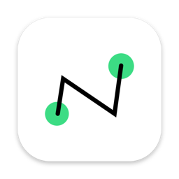
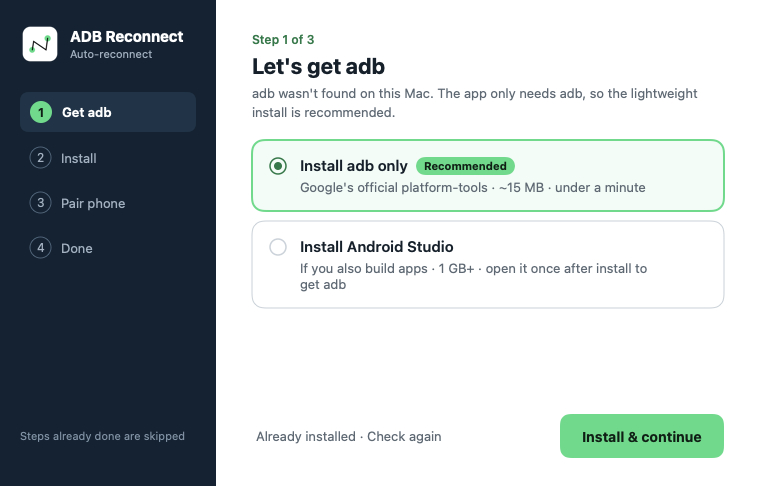
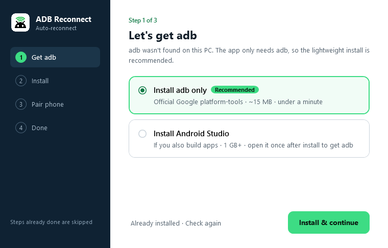
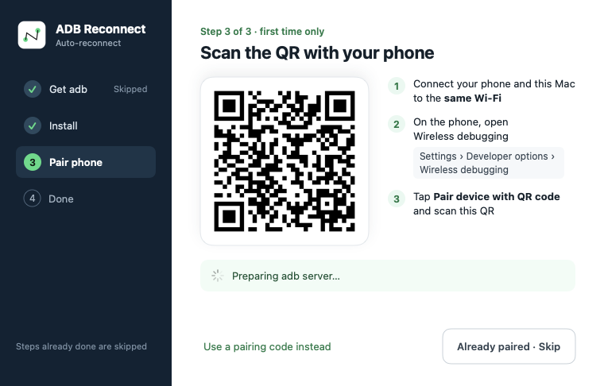
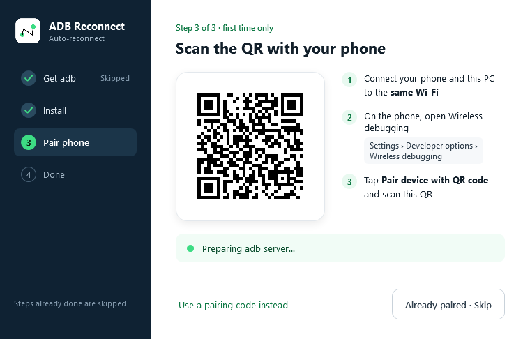
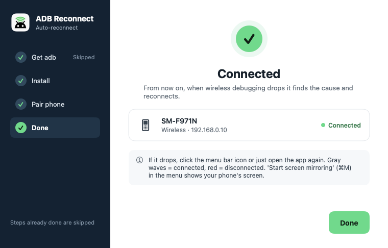
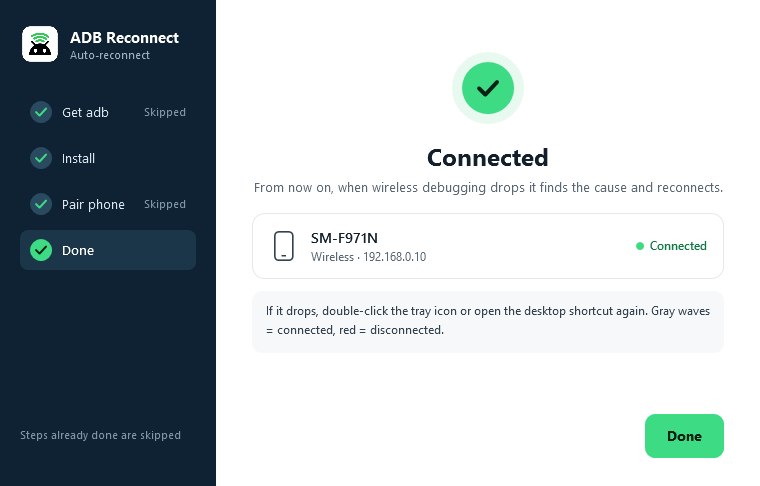

<p align="center">
  
</p>

<h1 align="center">Wireless ADB Reconnect</h1>

<p align="center">
  <b>Auto-reconnect wireless debugging (ADB over Wi‑Fi) on macOS &amp; Windows.</b><br>
  A menu bar / tray app that finds <i>why</i> your wireless adb dropped, tries the fixes in order, and remembers what worked.
</p>

<p align="center">
  <a href="../../releases/latest">Download</a> ·
  <a href="README.ko.md">한국어</a> ·
  <a href="#how-it-works">How it works</a> ·
  <a href="#troubleshooting">Troubleshooting</a>
</p>

---

## Why

Android 11+ **wireless debugging** is great until it isn't:

- the connection drops and `adb devices` is empty again,
- the **port changes** every time wireless debugging restarts,
- the phone's **IP changes** when it hops between Wi‑Fi networks or bands,
- another tool's adb (Android Studio, scrcpy, vendor tools) kills your server with a **version mismatch**,
- on macOS, an adb server started by the wrong process gets `No route to host` because of **Local Network privacy**.

The usual fix is `adb kill-server`, start it again, look up the new IP:port, `adb connect …` — over and over.
**Wireless ADB Reconnect does that for you in one click (or automatically at login) and tells you the cause.**

## Features

- **One click to reconnect** — click the menu bar / tray icon, or just open the app again.
- **Status at a glance** — the icon is 🟢 green when connected, 🔴 red when disconnected.
- **Diagnoses the cause** — who owns the adb server, Local Network permission (macOS), phone visible over mDNS, current IP:port, `offline` / `unauthorized` devices, adb version conflicts, Public network profile (Windows), pairing lost.
- **Tries fixes in order, learns** — stops at the first one that works and tries it first next time.
- **QR pairing** like Android Studio, plus pairing-code fallback. Retries automatically if the phone's IP changes mid-pairing.
- **Setup wizard** — installs Google's official **platform-tools (~15 MB)** if adb is missing (or Android Studio, if you prefer), installs the app, sets launch-at-login. Steps already done are skipped.
- **Native and tiny**
  - macOS 13+: Swift / SwiftUI, signed & notarized
  - Windows 10/11: single signed `.exe` (~0.5 MB) on built-in .NET Framework 4.8, **x64 and ARM64**

> The UI follows your OS language: **Korean** on Korean systems, **English** everywhere else.

## Screenshots

| macOS | Windows |
|---|---|
|  |  |
|  |  |
|  |  |

## Install

Download from [**Releases**](../../releases/latest).

### macOS (13 Ventura or later)
1. Unzip `WirelessADBReconnect-x.y.z-mac.zip` and open **Wireless ADB Reconnect**.
2. Follow the wizard → **Install & continue** moves it to `/Applications` and relaunches.
3. Allow **Local Network** when asked (needed to reach your phone).

### Windows (10 / 11, x64 or ARM64)
1. Run `WirelessADBReconnect-x.y.z-windows.exe` (code-signed with an EV certificate, publisher **LaonCross Inc.**).
2. Follow the wizard → installs to `%LOCALAPPDATA%\Programs\Wireless ADB Reconnect`, Start menu, optional desktop shortcut and launch at login.
3. Uninstall from **Settings → Apps**.

### First time on a computer: pair your phone
On the phone: **Settings › Developer options › Wireless debugging › Pair device with QR code**, then scan the QR shown by the app. Same Wi‑Fi required.

## How it works

The app owns its adb server (`adb nodaemon server` as a child process), so the server always has the app's network permission. When you reconnect:

1. **Diagnose** — devices and their states, who owns port 5037, phone discovery over mDNS and a TCP reachability test, network profile.
2. **Try, in order, stop at the first success:**

   | # | Strategy | Fixes |
   |---|---|---|
   | 1 | `adb reconnect offline` | device stuck `offline` |
   | 2 | keep server, `adb connect <IP:port from mDNS>` | port / IP changed |
   | 3 | restart the app-owned server, wait for auto-connect, then connect | stale or foreign server, version mismatch |
   | 4 | restart with the other mDNS backend | adb's mDNS not finding the phone |
   | 5 | *(macOS)* start the server from Terminal | app lacks Local Network permission |

3. **Remember** the strategy that worked and try it first next time.
4. **Tell you** — a notification with the result, or the most likely cause and what to do.

Logs: macOS `~/Library/Logs/wireless-adb-reconnect.log` · Windows `%LOCALAPPDATA%\Wireless ADB Reconnect\adb-revive.log`

## Troubleshooting

| Symptom | Likely cause | What to do |
|---|---|---|
| `No route to host` on macOS, phone visible | adb server started by a process without **Local Network** permission | Let the app own the server (reconnect from the app); allow it in *System Settings › Privacy & Security › Local Network* |
| "Phone not visible" | wireless debugging off, screen off / power saving, different Wi‑Fi, mDNS blocked | Open *Wireless debugging* on the phone; same Wi‑Fi; on Windows set the network to **Private** |
| `failed to authenticate` / `CERTIFICATE_UNKNOWN` | this computer isn't paired | Menu › *Pair phone* and scan the QR |
| keeps dropping after the phone switches Wi‑Fi | phone IP changes (randomized MAC) | Use the phone's device MAC for that Wi‑Fi, or a DHCP reservation |
| `doesn't match this client` | another adb (Android Studio, scrcpy…) | The app uses the Android SDK's adb first to avoid this |

More (in Korean): [docs/TROUBLESHOOTING.md](docs/TROUBLESHOOTING.md)

## Build from source

**macOS** (Xcode command line tools)
```bash
./mac/build_app.sh                                  # → dist/Wireless ADB Reconnect.app
NOTARY_PROFILE=<notarytool profile> ./mac/build_app.sh   # sign with Developer ID + notarize
```

**Windows** (.NET SDK on Windows)
```powershell
dotnet build windows\WirelessAdbReconnect\WirelessAdbReconnect.csproj -c Release
```

```
mac/        Swift menu bar app (main.swift: diagnosis & strategies, Setup.swift: SwiftUI wizard & pairing)
windows/    C# tray app (Reviver.cs: diagnosis & strategies, WPF wizard & pairing)
assets/     icons
docs/       plan, troubleshooting, screenshots
```

## Privacy

Everything runs locally. The only network access besides your phone is downloading Google's platform-tools, and only if you choose to install them.

## License

[MIT](LICENSE)

<sub>Keywords: wireless adb, adb wifi, adb over wifi, wireless debugging, auto reconnect, adb disconnect, adb connect port changed, android, macOS menu bar, Windows tray, scrcpy</sub>
